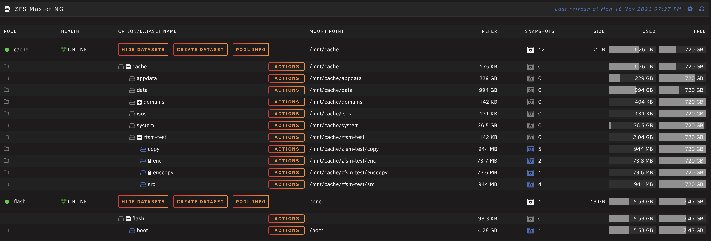

#  ZFS Master NG for Unraid

See and manage your ZFS pools, datasets and snapshots from Unraid's **Main** tab.

[](https://github.com/chodeus/ZFS-Master-NG/actions/workflows/ci.yml)
[](#requirements)
[](LICENSE)



## Features

- **Pools** — health, size, used and free space, snapshot counts
- **Pool Info** — which Unraid versions can import a pool read-write, and what an upgrade would change
- **Datasets** — create, rename, promote, destroy, and edit properties
- **Snapshots** — take, roll back, rename, clone, hold, release and delete; an icon warns when the newest gets old
- **Snapshots Admin** — filter, sort, browse a snapshot's files, or see what changed since it
- **Snapshot schedules** — snapshot every dataset hourly or on chosen days and keep the newest, plus the newest of each of the last days, weeks, months or years you choose; a dataset can have its own (not a read-only, legacy-mounted or Sanoid/Syncoid one), or none
- **Replication** — copy datasets to another pool or ZFS Master NG server, once or on a schedule, or every dataset into one dataset here on a schedule (Replicate Every Dataset)
- **Reviews** — destroy, rollback and bulk delete show what they'll remove first
- **Encryption** — create encrypted datasets, lock and unlock them
- **Directories** — list, move or delete folders, or convert one to a dataset (cloned instead of copied where it can)
- **Rewrite Files** — apply new compression or checksum settings to existing data (Unraid 7.3+)
- **Alerts** — optional notifications for pool problems and datasets whose newest snapshot is too old
- **ZnapZend** — optionally show each dataset's backup plans
- **Light** — no background daemon; reads ZFS only while the Main tab is open, or for alerts and schedules you turn on
- **Your view** — collapse datasets, or hide some with an exclusion pattern

## Actions

Each dataset row has an **Actions** menu. These items do more than their name says:

- **Replicate** — copies the dataset to another pool, or to another ZFS Master NG server added in Settings. Run it once, or repeat it hourly or on chosen days and keep the newest snapshots, plus the newest of each of the last days, weeks, months or years you choose; a copy in another pool can keep all of its snapshots, or keep by its own rules (Copy Keeps). New sends keep records larger than 128K whole; what a copy already holds stays as it is. A copy of an unencrypted dataset to a server travels compressed with zstd when both servers have it. A repeat follows the dataset when it is renamed, and its copy too when that moves under Copy Under; destroying the dataset removes it.
- **Schedules** — gives the dataset its own snapshot schedule (Snapshots) and its own copies into another pool (Replication), in place of Snapshot Every Dataset and Replicate Every Dataset (Settings). Each part is set on its own: Default follows the nearest dataset above with its own, else Settings; None stops that part only, so Replication None stops the copies under Copy Under while Snapshots on Default still takes snapshots, and a repeat set in Replicate still runs. Datasets below it follow it unless they have their own. Renaming the dataset renames its copies under Copy Under too, where a schedule still copies it or a dataset below it there, what is there is its copy (or holds the copies below it), its new name is free, and no dataset made to hold it would stop an encrypted copy due there; the rename says which stayed. Nothing is renamed while a copy of it or a dataset below it runs, or when the new name leaves no room for the bookmark a copy made now keeps where the old name did (named by Snapshots Pattern as it is now); a bookmark made before that no longer fits stays, and the rename says so.
- **Rewrite Files** (Unraid 7.3+) — writes the dataset's files again, so a changed compression, checksum, dedup or copies setting applies to data already there. Snapshots keep the old blocks, so the pool can use more space until they are deleted.
- **Snapshots Admin** — lists the dataset's snapshots, and its children's if you like, to filter and sort. From there you can browse a snapshot's files, see what changed since it, roll back, clone, hold, rename, or delete several at once.
- **Promote Dataset** (clones only) — makes a clone stand on its own, no longer tied to the snapshot it was cloned from. The original dataset can then be destroyed and the clone stays.
- **Lock / Unlock Dataset** (encrypted datasets) — Lock unmounts the dataset and unloads its key, so its files can't be read. Unlock asks for the passphrase and mounts it again.
- **Add Directory Listing** — shows the dataset's folders as rows under it on the Main tab. Each folder gets its own Actions: move or rename, delete, or convert to a dataset.
- **Convert to Dataset** (folder Actions) — turns a folder directly inside a dataset into a child dataset with the same name. Files are cloned where the pool can, otherwise copied, and the copy is checked before the folder is deleted.

## Coming next

- **Encryption passphrases** — change an encrypted dataset's passphrase

## Requirements

Unraid 6.9.2 or later. ZFS is built in from 6.12; older versions need a ZFS plugin.

## Install

Go to **Plugins → Install Plugin** and paste:

```text
https://raw.githubusercontent.com/chodeus/ZFS-Master-NG/main/zfs.master.plg
```

For the beta, which gets fixes and features first, paste `https://raw.githubusercontent.com/chodeus/ZFS-Master-NG/beta/zfs.master.plg` instead.

Renaming, editing and destroying datasets, and converting and deleting folders, need **Destructive Mode** in the plugin settings, as do rollbacks and deletes that take other snapshots with them. Snapshots to keep and Keep Replicas remove old snapshots by their own rules without it.

## Diagnostics

Settings, ZFS Master NG, Diagnostics, **Generate** makes one zip for a bug report: the plugin's settings, install and log, the pools and datasets as it reads them, and what it finds wrong. Dataset, snapshot and folder names, addresses and keys are replaced by tokens; pool names stay. Unraid's own diagnostics zip goes in as Unraid made it unless you untick the box. The zip is kept in `/boot/logs`. If the page does not load, run `/usr/local/emhttp/plugins/zfs.master/scripts/diagnostics.php` in a terminal.

## Credits

- [IkerSaint](https://github.com/IkerSaint/ZFS-Master-Unraid) — original creator of ZFS Master
- [dlang123](https://github.com/dlang123/ZFS-Master-Unraid) — Unraid 7.3 port and backend rewrite

## License

GPL, version 2 or later, the same as the original ZFS Master. See [LICENSE](LICENSE).

## Development

- `bash pkg_build.sh --version 0000.00.00 --out /tmp/zfsm` builds a package. It also rewrites the manifest's version and md5, so restore that file afterwards.
- [tests/README.md](tests/README.md) explains the test suites. They use fake `zfs` and `zpool` binaries and real Unraid webGUI code.
